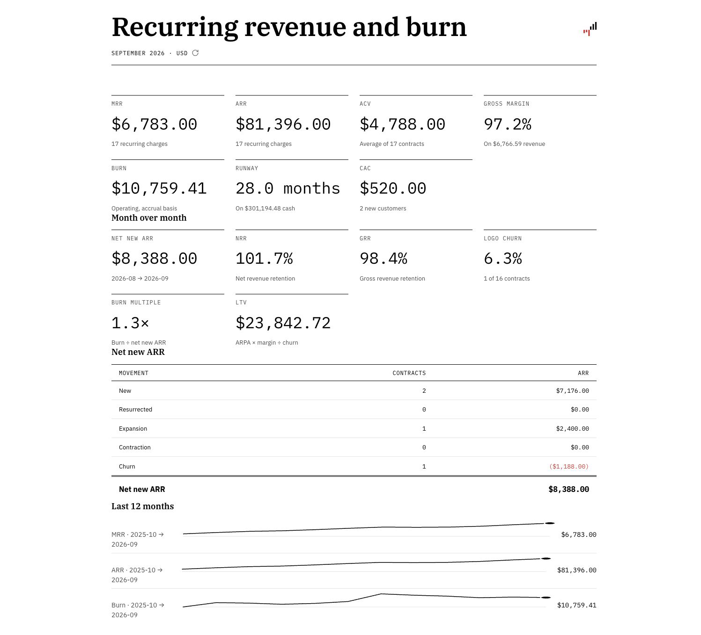
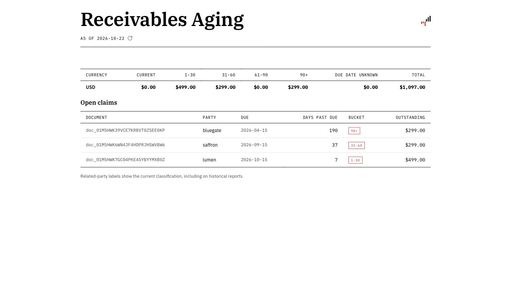
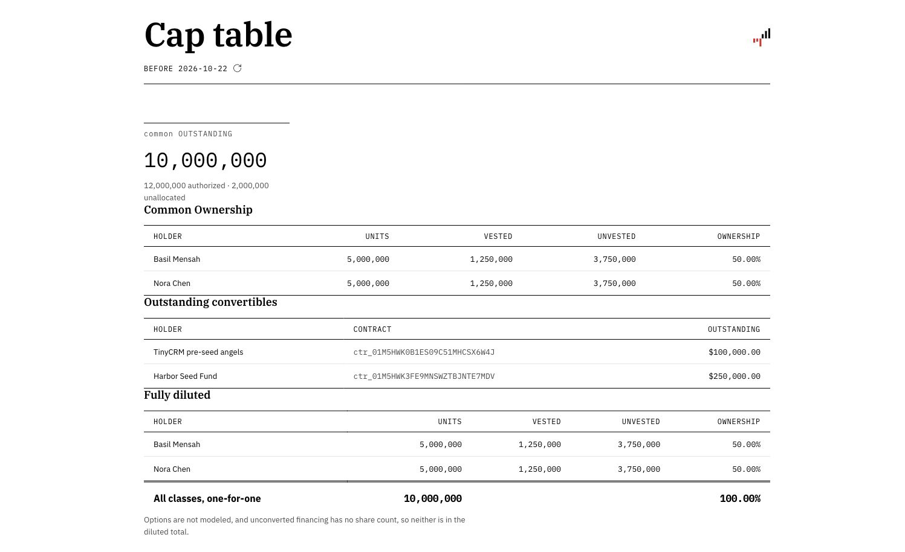

# Economico skills

Economico is the agentic finance function for ambitious founders who want the financial rigor of a company with a finance department, without hiring one.

Economico isn’t another copilot or dashboard to learn. Your own agent connects over MCP and does the work, recording each business’s history in a hash-chained, append-only ledger. The agreement is recorded first, so most reconciliation never has to happen.

The result is one connected history of what you charge, what each customer agreed to, what they used and what it costs to serve them. Financial statements, cash, runway and revenue all come from that history. Ask what your burn is, then ask which customer, agreement or assumption changed it.

**[Connect your agent](https://economi.co/connect/).** Explore TinyCRM Studio, a fictional SaaS
company with its own customers, subscriptions and funding, before bringing your own books.
You choose the business and permissions. Code, Stripe and email access are separate connections
you authorize in your agent; Economico does not automatically read those services.

## See the business behind the numbers



Ask: “Show recurring revenue, burn and runway for September 2026.” The demo report shows the
recorded amounts and calculation basis; the answer depends on the books and assumptions supplied.



Ask: “What do customers still owe us as of October 22, 2026?” See each outstanding invoice and
how long it has been overdue.



Ask: “Show the cap table before October 22, 2026.” Inspect founder ownership and outstanding
convertible financing, including what the diluted total excludes.

These are Economico MCP App views captured from a disposable TinyCRM demo in a local protocol
host. Directory availability and rendering in each agent depend on that host's support and review.

## Skills

| Skill | What it does |
|---|---|
| `economico` | Connects Economico and models your business in it: reads your product's code, Stripe and email to learn what you sell, to whom, and what it costs to run, records plans, customers, vendors and receipts, and proves the books with reports. Your agent picks it up when you ask about your books. |
| `add-customer` | `/add-customer`: add a customer with a contract on one of your plans. |
| `send-invoice` | `/send-invoice`: bill a customer and get the invoice to send. |
| `record-payment` | `/record-payment`: record a customer's payment against an invoice. |
| `record-vendor-invoice` | `/record-vendor-invoice`: record a bill a vendor sent, with the invoice as evidence. |
| `record-receipts` | `/record-receipts`: find vendor receipts and bills in your email and record them. |
| `investor-update` | `/investor-update`: draft this month's investor update from the books. |

The slash-command skills are shortcuts you type. Each hands your request to the `economico`
skill, so install them together.

## Install

Any agent that reads `~/.agents/skills/` (Claude Code, Codex, Hermes, OpenClaw):

```sh
npx skills add economico/cfo-skills
```

Claude Code, as a plugin:

```sh
/plugin marketplace add economico/cfo-skills
/plugin install economico@cfo-skills
```

Then ask your agent to set up Economico. The `economico` skill connects it (MCP or the
`@economico/cli`) and walks you through the first session. Open TinyCRM Studio from the connection screen to explore your own demo copy first.

## OpenAI plugin

The pack also carries a Codex plugin manifest and Economico’s remote MCP configuration.
The OpenAI submission ZIP is built from the source repository; directory availability depends
on OpenAI review and publication. Installing skills alone does not connect an MCP server.
Stripe and email access are separate connections you authorize in your agent.

## Versions

Releases are tagged `vX.Y.Z` and described in [CHANGELOG.md](./CHANGELOG.md). A major version
removes or renames a skill; a minor one adds a skill, a reference or a recipe; a patch fixes
wording.

This repository is published from Economico's own repository, where the skills are developed and
evaluated. Please open issues here; changes are made there and published.

## License

[MIT](./LICENSE)
