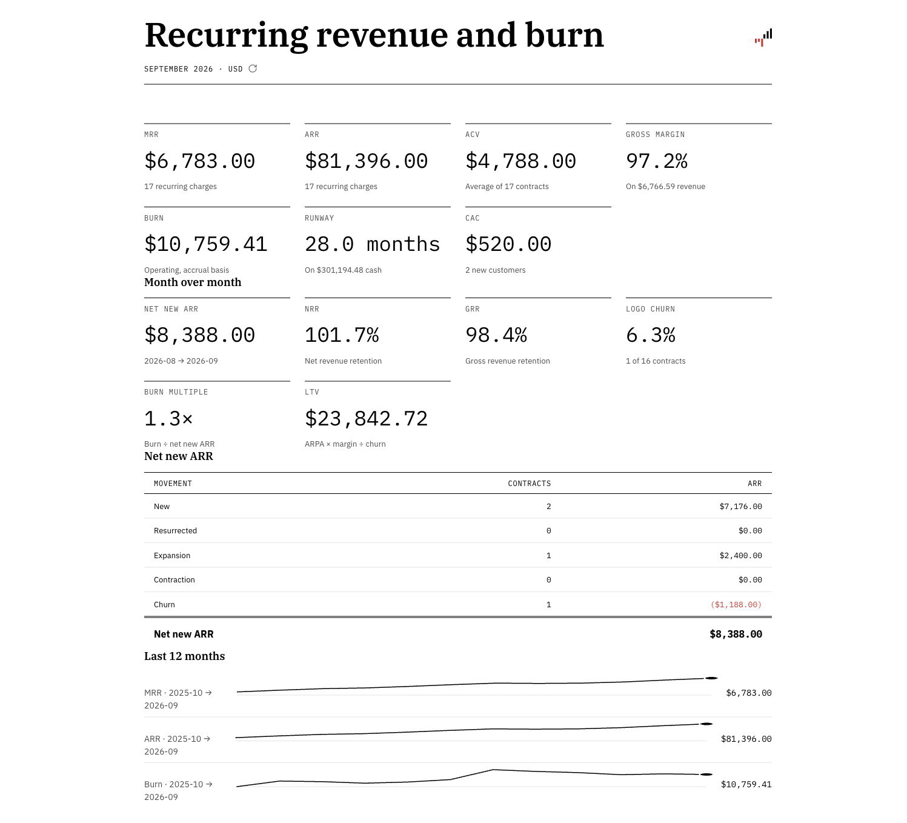
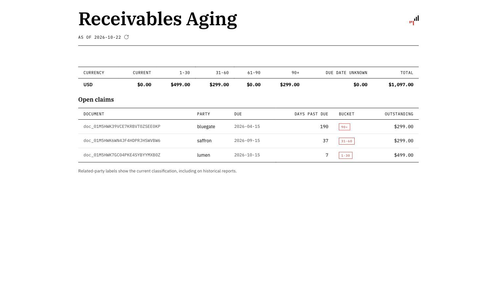
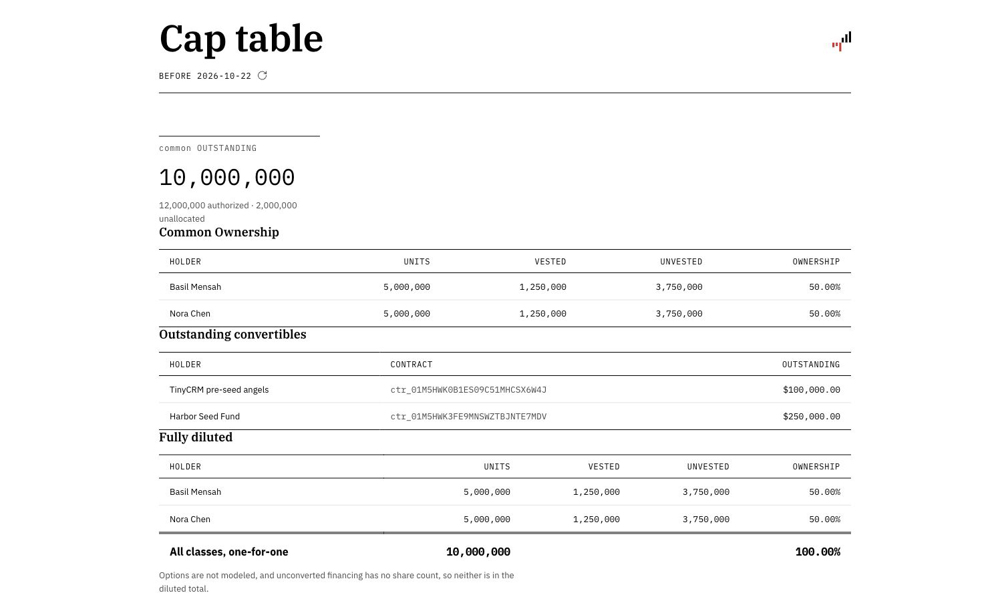

# Economico skills

Economico is the ERP for ambitious founders and their agents.

Your own agents connect over MCP and run it: they record what you charge, what each customer agreed to, what they used and what it costs to serve them, as real double-entry books. Financial statements, cash, burn, runway and revenue all come from that one record. Ask what your burn is, then ask which customer, agreement or assumption changed it.

It is your own source of truth, beside your bank and your bookkeeper's tools; your agents can read those and tie them in. Try it on a demo company first. Free for a single founder, no card required.

**[Connect your agent](https://economi.co/connect/).** Explore TinyCRM Studio, a fictional SaaS
company with its own customers, subscriptions and funding, before bringing your own books.
You choose the business and permissions. Code, Stripe and email access are separate connections
you authorize in your agent; Economico does not automatically read those services.

## See the business behind the numbers



Ask: “Show recurring revenue, burn and runway for September 2026.” The demo report shows the
recorded amounts and calculation basis; the answer depends on the books and assumptions supplied.



Ask: “What do customers still owe us as of October 22, 2026?” See each outstanding invoice and
how long it has been overdue.



Ask: “Show the cap table before October 22, 2026.” Inspect founder ownership and outstanding
convertible financing, including what the diluted total excludes.

These are Economico MCP App views captured from a disposable TinyCRM demo in a local protocol
host. Directory availability and rendering in each agent depend on that host's support and review.

## Skills

| Skill | What it does |
|---|---|
| `economico` | Core foundation: connects Economico, runs first and later sessions, verifies and shows the books, and holds shared references (`payments`, `accounts`, `evidence`, `verify`, `pipelines`, `conversation-intake`). |
| `manage-sales` | Sales pipeline, customer offers and contracts, billing, invoicing, reminders, collections and Stripe payouts. |
| `product-economics` | Founder-facing pricing plans, reusable rights, patterns, tiered pricing, vendor-catalog publishing and unit economics. |
| `integrate-product` | Developer-facing backend integration over REST or MCP for sign-ups, contracts, plan changes and live usage. |
| `manage-vendors` | Purchasing pipeline, adopting or modelling vendor agreements, email receipts, vendor bills, subscriptions and usage. |
| `hiring` | Hiring pipeline, candidate tracking and closing accepted offers in one motion with People arrangements and headcount membership. |
| `manage-people` | People arrangements (employees, EOR, PEO, contractors), provider payroll runs, funding, returns, corrections and named seats. |
| `fundraise` | Fundraising pipeline, closing SAFEs, convertible notes and priced rounds, funding commitments, conversions and wires. |
| `setup-company` | Company profile, legal entity and incorporation, bank accounts, cards, wallets, founder equity, cap table and LLC/project capital accounts. |
| `plan-and-track` | Goals, KPIs, OKRs, V2MOMs, measures, quotas, operating plans, plan-vs-actual and custom business views. |
| `investor-update` | `/investor-update`: build and publish this month's investor update from the books as a frozen link or Markdown draft. |
| `add-customer` | `/add-customer`: shortcut to add a customer with a contract on one of your plans. |
| `send-invoice` | `/send-invoice`: shortcut to bill a customer and email them the invoice. |
| `record-payment` | `/record-payment`: shortcut to record a customer's payment against an invoice. |
| `record-vendor-invoice` | `/record-vendor-invoice`: shortcut to record a bill a vendor sent, with the invoice as evidence. |
| `record-receipts` | `/record-receipts`: shortcut to find vendor receipts and bills in your email and record them. |

The action skills and task shortcuts work both over MCP (Skills over MCP) and when installed from
this plugin, sharing the core `economico` foundations.

## Install

Any agent that reads `~/.agents/skills/` (Claude Code, Codex, Hermes, OpenClaw):

```sh
npx skills add economico/cfo-skills
```

Claude Code, as a plugin:

```sh
/plugin marketplace add economico/cfo-skills
/plugin install economico@cfo-skills
```

Then ask your agent to set up Economico. The `economico` skill connects it (MCP or the
`@economico/cli`) and walks you through the first session. Open TinyCRM Studio from the connection screen to explore your own demo copy first.

## OpenAI plugin

The pack also carries a Codex plugin manifest and Economico’s remote MCP configuration.
The OpenAI submission ZIP is built from the source repository; directory availability depends
on OpenAI review and publication. Installing skills alone does not connect an MCP server.
Stripe and email access are separate connections you authorize in your agent.

## Versions

Releases are tagged `vX.Y.Z` and described in [CHANGELOG.md](./CHANGELOG.md). A major version
removes or renames a skill; a minor one adds a skill, a reference or a recipe; a patch fixes
wording.

This repository is published from Economico's own repository, where the skills are developed and
evaluated. Please open issues here; changes are made there and published.

## License

[MIT](./LICENSE)
